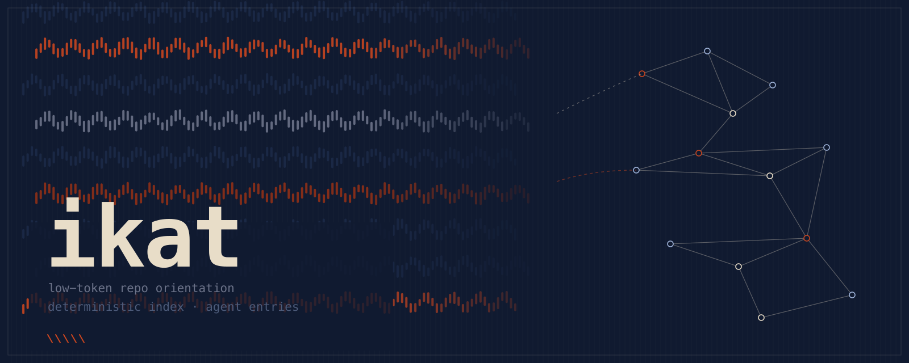
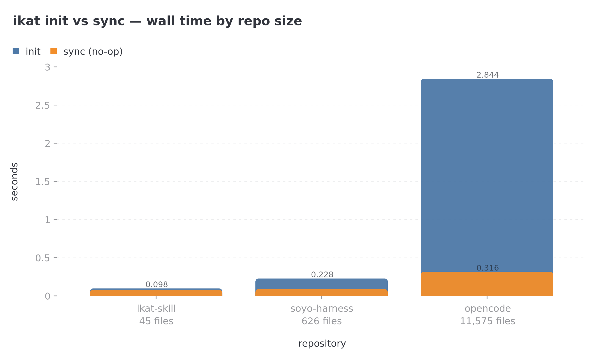
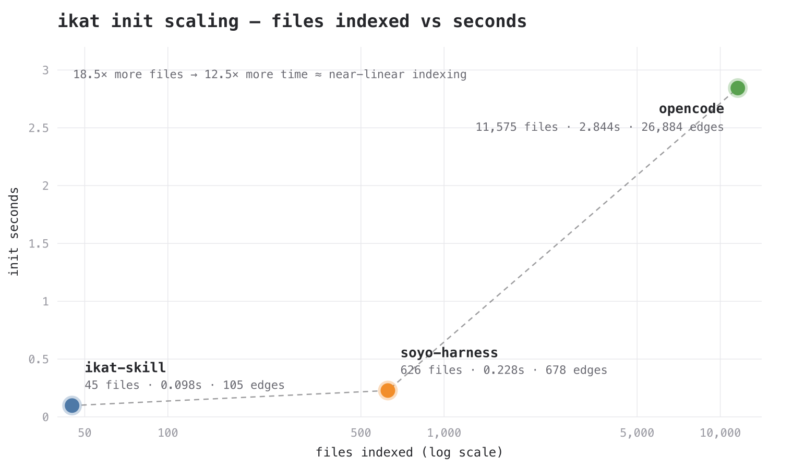

# ikat

[English](README.md) · **中文**

[](https://www.npmjs.com/package/ikat-cli)
[](LICENSE)
[](https://nodejs.org)
[](package.json)
[](https://skills.sh)

为编码 agent 准备的低 token 仓库认知工具。`ikat` 为你的仓库构建一份
**确定性、本地化的索引**——文件角色、import 关系图、文档注释、媒体
元数据——再渲染成有界的 `digest.md`。agent 先读它，而不是重新扫描
整个目录树。没有模型调用、没有守护进程、没有网络请求——索引里的一切
都是测量出来的证据。

```
$ npx ikat-cli@latest init

ikat 0.1.0 · /repo
files  · 626 (source 338 · test 100 · config 41 · asset 20 · document 127)
edges  · 678 internal · 132 external
digest · .ikat/digest.md (6.2 KB)
marker · appended
ignore · .git/info/exclude added
```

## 安装与运行

```bash
npx ikat-cli@latest init          # 索引当前仓库（零安装）
npm i -g ikat-cli                 # 或全局安装 → `ikat init`
```

需要 Node ≥ 20，零运行时依赖。

## 给 Agent 用

CLI 只是产品的一半，另一半是 **agent skill**（`SKILL.md`）——教 agent
什么时候、怎么用这套 CLI。

### 安装 skill

```bash
npx skills add Ariakage/ikat-skill
```

通过开放的 [skills](https://skills.sh) 安装器把 `SKILL.md` 放进 agent
的 skill 目录（`.claude/skills/`、`.devin/skills/`、`.agents/skills/`，
支持 75+ 种 agent）。在项目内执行是项目级安装，加 `-g` 为全局安装。

### 触发方式

- **描述匹配**——skill 安装后暴露 `description`，任务与之匹配时 agent
  自动加载：进入陌生仓库、问"这个项目什么结构"、"X 是怎么到 Y 的"、
  "给这个代码库画架构图"。
- **显式调用**——在 prompt 里直接说 `use ikat` 或 `/ikat`。
- **AGENTS.md 标记**——`ikat init` 追加 `<!-- ikat:index -->` 块后，
  之后每个 agent 会话都会自动被指引到 `.ikat/digest.md`，不需要再次
  唤起 skill。

### 一行启动 prompt（免安装）

在任何仓库的会话开头粘贴这段即可：

```text
Run `npx ikat-cli@latest init`, read `.ikat/digest.md` for architecture
context, then use `ikat file` / `ikat refs` / `ikat diagram` to drill down
instead of re-scanning files. Run `ikat sync` after edits to keep the
index fresh.
```

## 产物结构

```
.ikat/
├── index.json      # L0 存储：每个文件的 role/lang/hash/imports/exports/doc/rank
├── digest.md       # 有界的导读文档——agent 首先读它（约 500–3.5k tokens）
├── entries.txt     # L1 覆盖层：agent 撰写的 FRAS 行，hash 绑定
├── diagram.mmd     # Mermaid 基线（仅由 `diagram --draft` 写入）
├── converted/      # markitdown 转换缓存，按源文件 hash 索引
└── meta.json       # 工具版本、HEAD、统计、探测环境
```

默认将 `.ikat/` 加入 `.git/info/exclude`（索引仅本地使用）。
`ikat init --tracked` 跳过该步骤，索引即可提交共享。

## 命令一览

| 命令 | 作用 |
|---|---|
| `ikat init [path]` | 构建索引 + digest + AGENTS.md 标记。`--tracked` 让 `.ikat/` 入 git；`--no-marker` 跳过标记；`-q` 静默 |
| `ikat status [path]` | 相对 `HEAD` 的新鲜度、计数、覆盖率。`--json` 供脚本用。stale 也是正常状态（exit 0） |
| `ikat digest [path]` | 打印渲染后的 digest |
| `ikat file <path>` | 元数据卡 + 有界摘录。`--lines a-b`、`--full`。二进制文件出 probe 卡而非字节流 |
| `ikat refs <path>` | 出向 imports / 外部包 / 入向引用。`--json` |
| `ikat sync [path]` | 增量刷新：未变文件（size+mtime）直接复用，边全局重解，孤儿条目清理 |
| `ikat put <path>` | 写入条目（`--entry "S:…"` 或 stdin `path[TAG]: F|R|A|S`）。绑定文件实时 hash |
| `ikat enrich [path]` | 按 rank 排序的缺条目队列——兼顾近期变更与子系统覆盖。`--limit`、`--only-stale`、`--json` |
| `ikat diagram [--draft]` | 无参打印当前 `.mmd`；`--draft` 重新生成确定性 Mermaid 基线（你的编辑不会被覆盖，除非再次 `--draft`） |
| `ikat convert <path>` | 文档 → Markdown，走 markitdown，按 hash 缓存。shim 失效时回退 `uvx markitdown` |
| `ikat doctor` | 验证可选工具是否真的能跑（不只是 PATH 存在）。`--json` |
| `ikat uninit [path]` | 移除 `.ikat/`、AGENTS 标记与 exclude 条目——完全可逆 |

## 双层模型

**L0 — 测量层（零成本）。** CLI 用 `git ls-files` 盘点文件清单，逐文件
做角色分类、sha1，再按语言的正则表提取 imports/exports/文档注释。
specifier 对照真实文件集解析——NodeNext `.js`→`.ts`、Python 点路径、
Rust `crate`/`self`/`super` + 同名目录模块、workspace 包名
（`@scope/pkg` → `packages/pkg`，走 `exports`）、tsconfig `paths`
别名。凡是结构能免费推断的，绝不留给模型。

**L1 — 撰写层（agent 的 token 花在这里）。** agent 在 `entries.txt` 里
每文件写一行：

```
src/session.ts[XIS]: F:..|R:..|A:..|S:.. @hash12
```

字段任意子集都合法——F（职责）和 A（契约）通常已被提取的 doc/exports
覆盖，真正的增量是 **S**：代码推断不出、但不能搞错的约束。行与文件
hash 绑定；漂移时标 `stale` 而不删除。CLI 校验结构与出处——绝不改写
你写的文字。校验通过 ≠ 内容正确：它保证契约，不保证论断。

`digest.md` 把两层合并：fresh 条目的 F 覆盖提取出的 doc，覆盖率如实
汇报（`entries 3/12 fresh (25%)`）。

## 媒体与文档

- **探测兜底链**：内置 magic bytes → `file` → `ffprobe` →
  `exiftool`/`pdfinfo` → 扩展名兜底。缺工具降级不报错，
  `media.tool` 记录实际到达的最深一层。
- **委托而非解读**：音视频交给内容向 skill，图片交给宿主视觉能力。
  ikat 只说*是什么、在哪*，从不说*里面是什么*——不做 OCR、转写或
  内容描述。
- **文档**（pdf/docx/xlsx/pptx/epub/html/ipynb）：`ikat convert`
  惰性调用 [markitdown](https://github.com/microsoft/markitdown)，
  按 hash 缓存；转换后的文档进入普通文本管道。
- sidecar 免费检测：`clip.mp4` 旁边的 `clip.srt`/`clip.md` 会直接
  出现在它的卡片上。

跑 `ikat doctor` 看你环境里哪些可选工具真正可执行——它用 `--version`
实测，不是只查 PATH。

## 架构图

`ikat diagram --draft` 输出确定性的 `flowchart LR` 基线：高 rank 模块
为节点（按目录聚簇），已解析的 import 为边——每条边都有证据，绝不虚构。
它本来就该被*编辑*：保留证据，修标签。装了 `mmdc`（Mermaid CLI）可以
自行渲染；ikat 从不替你安装工具。

## 性能

本机实测（文件系统缓存热态）：

| 仓库 | 文件数 | `init` | `sync`（无变更） | 内部边 |
|---|---|---|---|---|
| ikat-skill | 45 | 0.098 s | 0.076 s | 105 |
| soyo-harness | 626 | 0.23 s | 0.088 s | 678 |
| opencode | 11,575 | **2.8 s** | 0.32 s | 26,884 |

`sync` 按 size+mtime 复用未变条目——11.5k 文件规模下比冷 init
便宜约 9 倍。媒体探测对外部工具调用做了批量合并，而不是每个资源文件
起一个进程。



蓝橙两列之间的差距就是产品论点本身：建索引是一次性成本，
新鲜度检查近乎免费。



## 边界

- CLI 内部永不调用模型。
- 索引是证据，不是真理神谕。stale 如实展示，从不隐藏。
- CLI 校验条目格式与 hash 绑定；你撰写的文字归你所有。

## 开发

```bash
pnpm install
pnpm test          # vitest
pnpm typecheck     # tsc --noEmit
pnpm lint          # biome
pnpm build         # tsup → dist/cli.js
node dist/cli.js init /some/repo
```

设计决策见 `docs/design.md`，里程碑状态见 `docs/progress.md`，
agent 侧契约见 `SKILL.md`。

## License

MIT
